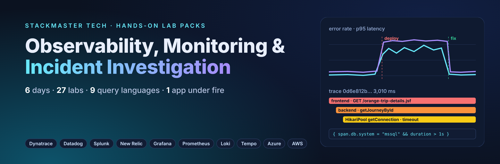
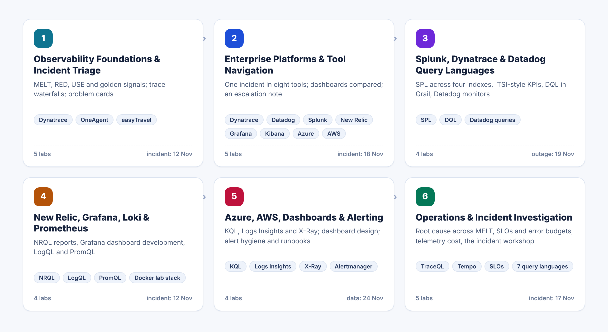
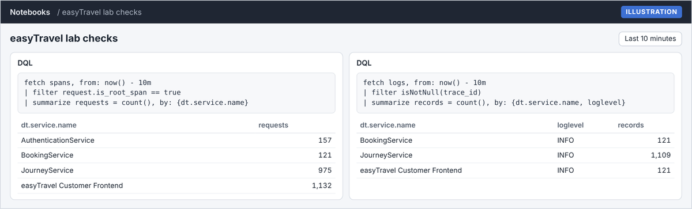
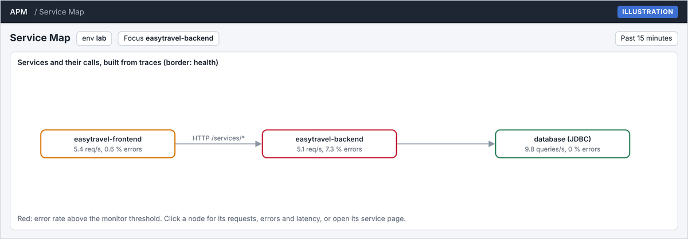
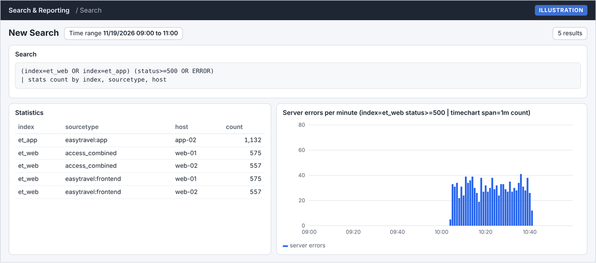
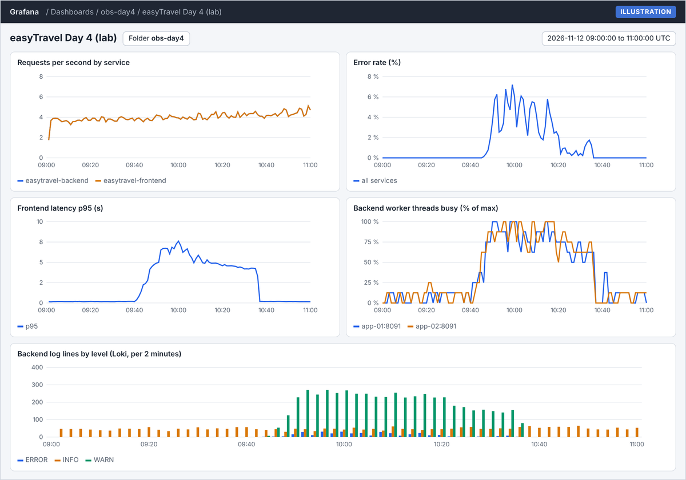
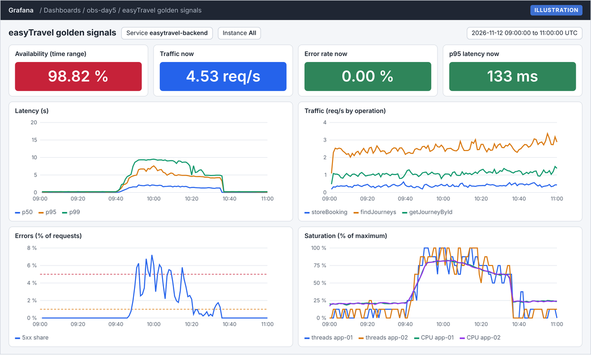
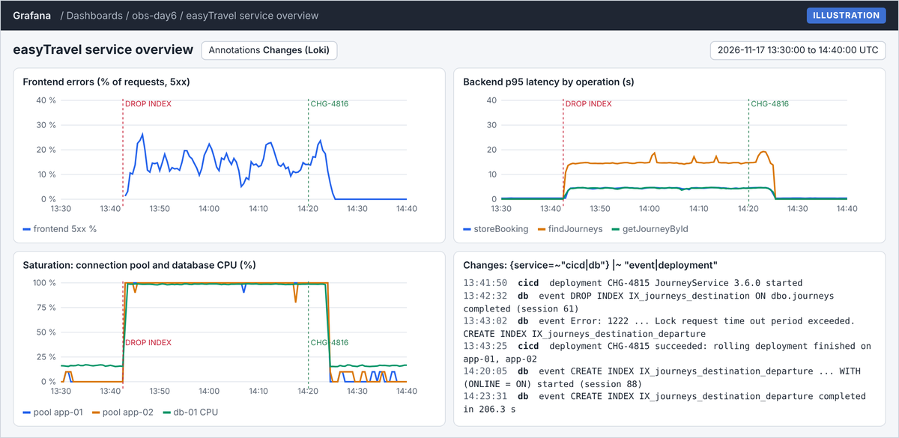

<p align="center">
  
</p>

<p align="center">
  
  
  
  
  
</p>

<p align="center">
  <b>Break it. Find it. Fix it. Prove it.</b><br>
  Six days of hands-on observability, from the first triage to a full incident report, on one application under fire.
</p>

---

## 🚀 What is this?

The lab packs of a six-day, hands-on observability course by **StackMaster Tech**. Every day has its own folder,
`obs-day1` to `obs-day6`, with the data, scripts, dashboards and queries its labs use. A **Study Guide** and a
**Lab Guide** go with every day: the Lab Guide tells you which file to use, when, and what result to expect.

🧳 **One app, all week.** Everything runs on **easyTravel**, Dynatrace's demo travel-booking shop. Live labs run it on a VM
with an agent and switch its *problem patterns* on and off on a timer. Offline labs use recorded incidents of the same
app, so everyone sees the same data and the guides can give **exact expected results**.

🔒 **Safe by design.** All data is invented: example.com names, documentation IP ranges, no real people or customers.
All times are UTC.

## 🗺️ The six-day journey

<p align="center">
  
</p>

| | Day | You learn to | Labs | Folder |
| :-: | --- | --- | :-: | --- |
| 🧭 | **1 · Observability Foundations & Incident Triage** | Read an incident through MELT, build RED and USE dashboards, follow a trace waterfall to its logs, decide the next action from a problem card | 5 | [`obs-day1`](obs-day1) |
| 🛰️ | **2 · Enterprise Platforms & Tool Navigation** | Chase one incident through Dynatrace, Datadog, Splunk, New Relic, Grafana, Kibana, Application Insights, CloudWatch and X-Ray, then write the escalation note | 5 | [`obs-day2`](obs-day2) |
| 🔎 | **3 · Splunk, Dynatrace & Datadog Query Languages** | Crack an outage with SPL across four indexes, build ITSI-style KPIs, query Grail with DQL, tame Datadog monitors | 4 | [`obs-day3`](obs-day3) |
| 📈 | **4 · New Relic, Grafana, Loki & Prometheus** | Write NRQL reports, develop Grafana dashboards, filter and parse logs with LogQL, compute rates and percentiles with PromQL | 4 | [`obs-day4`](obs-day4) |
| ☁️ | **5 · Azure, AWS, Dashboards & Alerting** | Correlate with KQL, trace Lambdas with Logs Insights and X-Ray, design golden signal dashboards, cut alert noise | 4 | [`obs-day5`](obs-day5) |
| 🚨 | **6 · Operations & Incident Investigation** | Find a root cause across metrics, logs and traces, spend an error budget, price your telemetry, then run a full incident workshop in seven query languages | 5 | [`obs-day6`](obs-day6) |

## 🔥 The incidents

Every day hands you a new mystery. It starts from what users noticed; the cause is yours to find.

| | Day | What users noticed | Evidence in the pack |
| :-: | --- | --- | --- |
| 💳 | 1 | 12 November 2026: bookings fail in easyTravel production | `obs-day1/incident/`: metrics, events, logs, spans, problems |
| 🐢 | 2 | 18 November 2026, 09:00 to 11:00: searches crawl, bookings time out | `obs-day2/bundle/`: logs, access log, traces, metrics, events |
| 💥 | 3 | 19 November 2026, about 10:05 to 10:45: searches and bookings fail | `obs-day3/data/`: four Splunk indexes, two lookups |
| 🧵 | 4 | 12 November 2026, 09:00 to 11:00: a deployment, then rejected requests | `obs-day4/data/`: Prometheus metrics, Loki logs |
| ⏰ | 5 | Azure and AWS telemetry, plus 14 days of noisy alerts to clean up | `obs-day5/data/`, `obs-day5/alerts/` |
| 🕵️ | 6 | 17 November 2026, 13:00 to 15:00: one request in six fails after a release | `obs-day6/data/`: the same incident in Prometheus, Loki, Tempo, Splunk and Azure formats, plus 28 days of SLO counters |

♻️ Every data set is rebuilt by the `make_*.py` script in its folder, from a fixed seed: the same files every time.

## 🖼️ A look inside

<table>
  <tr>
    <td width="50%"><br><sub>🧭 <b>Day 1</b> · first DQL check: is the telemetry arriving?</sub></td>
    <td width="50%"><br><sub>🛰️ <b>Day 2</b> · the service map, built from traces</sub></td>
  </tr>
  <tr>
    <td><br><sub>🔎 <b>Day 3</b> · SPL across four indexes during the outage</sub></td>
    <td><br><sub>📈 <b>Day 4</b> · the Grafana dashboard you build on Prometheus and Loki</sub></td>
  </tr>
  <tr>
    <td><br><sub>☁️ <b>Day 5</b> · a golden signals dashboard for one service</sub></td>
    <td><br><sub>🚨 <b>Day 6</b> · metrics, changes and the moment it broke</sub></td>
  </tr>
</table>

<sub>These are illustrations drawn from the lab data, not screenshots of the products.</sub>

## 🧰 What you need

| Day | 🖥️ Live environment | 🛠️ Local tools | 🔑 Accounts (free tiers or trials) |
| :-: | --- | --- | --- |
| 1 | Ubuntu VM with easyTravel and Dynatrace OneAgent | Python 3 | Dynatrace |
| 2 | Two VMs: easyTravel with Dynatrace, easyTravel with Datadog | Python 3, `jq`, `awk` | Dynatrace, Datadog, Splunk, New Relic, Elastic Cloud, AWS; any Grafana |
| 3 | The Dynatrace and Datadog VMs of Day 2 | Python 3 | Splunk Enterprise (trial or free) or Splunk Cloud trial |
| 4 | A VM with easyTravel and the New Relic Java agent | Docker with Compose v2, Python 3 | New Relic |
| 5 | None (the Day 4 lab stack for Labs 5.3 and 5.4) | Docker, Python 3 with PyYAML | Azure Data Explorer free cluster, AWS (CloudShell) |
| 6 | One of the Dynatrace, Datadog or New Relic VMs (Lab 6.5) | Docker with Compose v2, Python 3 with PyYAML | Splunk, Azure Data Explorer free cluster |

🐳 The Docker lab stacks (Days 4 and 6) run Prometheus 3.5.0, Loki 3.5.3, Grafana 12.1.1 and, on Day 6, Tempo 2.8.2,
preloaded with the incident data. They need about 2 vCPU, 4 GB of memory and the ports 3000, 9090 and 3100 (plus 3200
and 4318 on Day 6).

🐍 The helper scripts use the Python standard library only, except `alert_sim.py` (PyYAML) and the AWS loaders (boto3,
already in CloudShell).

ℹ️ easyTravel is deprecated by Dynatrace in favour of easyTrade, but it still installs and runs on Ubuntu 20.04 and
22.04 for training. Day 1's Lab Guide shows the installation; Days 2 to 6 reuse the same VMs.

## ⚡ Quick start

Each folder has its own README with every file explained. Pick your day:

<details>
<summary>🧭 <b>Day 1</b> · on the easyTravel VM</summary>

```bash
cd obs-day1
python3 bin/check.py               # easyTravel and OneAgent up?
python3 bin/scenario.py lab12      # 12-minute problem-pattern scenario for Lab 1.2
```
</details>

<details>
<summary>🛰️ <b>Day 2</b> · offline helpers, then the live scenarios</summary>

```bash
cd obs-day2
python3 bin/check.py               # on a lab VM
python3 bin/scenario.py lab21      # Dynatrace VM (use lab22 on the Datadog VM)
```
</details>

<details>
<summary>🔎 <b>Day 3</b> · Splunk</summary>

Install `splunk/obs_day3_app.tgz` in Splunk (Apps › Manage Apps › Install app from file), restart, then:

```bash
cd obs-day3
python3 bin/expected.py            # expected result of every Splunk exercise
```
</details>

<details>
<summary>📈 <b>Day 4</b> · the lab stack</summary>

```bash
cd obs-day4
docker compose up -d
python3 bin/check.py stack         # Grafana on http://localhost:3000
```
</details>

<details>
<summary>☁️ <b>Day 5</b> · Azure and AWS</summary>

Run `setup/create-tables.kql` in your Azure Data Explorer free cluster and load `data/azure/*.csv`. Then in AWS CloudShell:

```bash
cd obs-day5
python3 bin/load_aws.py            # prints your T0
python3 bin/check.py aws
```
</details>

<details>
<summary>🚨 <b>Day 6</b> · the lab stack with Tempo</summary>

```bash
cd obs-day6
docker compose up -d
python3 bin/check.py stack         # Prometheus, Loki, Tempo, Grafana
```
</details>

## 📏 How to read the guides

- ✅ **Expected output** marks a real result: run against the lab data with the tool named in the guide, or computed
  from the data files by the folder's `bin/expected.py`. Live results (agents on a VM, SaaS tools) differ per learner and
  are described, not quoted.
- 🖼️ **Illustration** marks a picture of a screen drawn from the lab data, not a screenshot of the product.
- 🛟 Every lab has an offline variant or a recorded data set, so it still works when a trial account or a VM is missing.

## 🔐 Secrets

> [!IMPORTANT]
> **Lab-only secrets, never committed.** License keys, API keys, ingest and HEC tokens and cloud credentials are typed
> into the shell with `read -rs` (for example `read -rs NEW_RELIC_LICENSE_KEY && export NEW_RELIC_LICENSE_KEY`). They are
> never written into a file of these folders, a chat, a ticket or a screenshot.

Each folder's `.gitignore` excludes `*.env` and the generated files that could hold account details. The Docker lab
stacks hold no secrets; change Grafana's admin password at first login.

## 🧹 Clean up

Each folder's README ends with its own clean-up steps. In short:

- [ ] `python3 bin/pattern.py reset` on every easyTravel VM
- [ ] `docker compose down -v` for the lab stacks
- [ ] Remove the Splunk apps and their indexes
- [ ] Delete the Azure Data Explorer databases
- [ ] `python3 obs-day5/bin/load_aws.py --delete` and `python3 obs-day2/bin/to_aws.py --delete` in AWS
- [ ] Delete the dashboards, monitors, notebooks and keys you created in the trial accounts
- [ ] Remove trial VMs from Dynatrace, Datadog and New Relic

## 👤 Author

**Vivek Arora** · Corporate Trainer, Author & Consultant · StackMaster Tech, Bengaluru

[](https://www.linkedin.com/in/vivek11arora)
[](https://github.com/vivek9325)
[](https://www.youtube.com/@StackMasterTech)

⭐ If these labs helped you, star the repo and share it with your team.

<sub>Dynatrace, easyTravel, Datadog, Splunk, New Relic, Grafana, Elastic, Microsoft Azure and AWS are trademarks of their
respective owners. This course material is independent and not endorsed by them.</sub>
